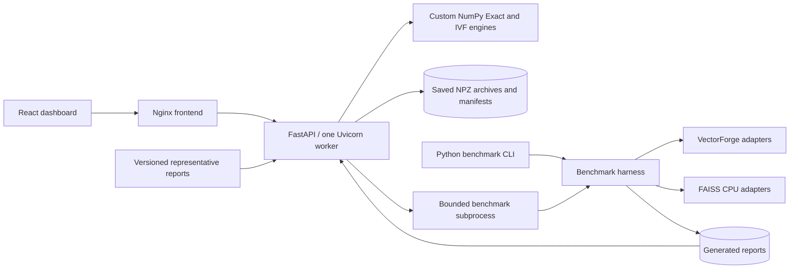

# VectorForge

VectorForge is a vector similarity search engine I built in Python and NumPy,
with custom Exact Search, K-Means++, and inverted-file (IVF) search. It includes
FAISS benchmarks, a FastAPI backend, a React dashboard, and Docker Compose support.
FAISS is an external comparison baseline; it is never used inside VectorForge's
search or clustering algorithms.

## Why I Built It

I wanted to understand what a vector index does between receiving a query and
returning its nearest neighbors. Building the algorithms made me work through
scoring, top-k selection, clustering, and the trade-off between recall and search
cost. Adding an API and dashboard brought in the less visible work: validation,
stable IDs, persistence, concurrency, and managing benchmark subprocesses.

## Key Features

- Exact and IVF search with cosine similarity, unsquared Euclidean distance, and
  dot product.
- Seeded K-Means++ initialization and Lloyd iteration, including deterministic
  recovery of empty training clusters.
- Deterministic ranking by score and ascending ID, including ties at the top-k
  boundary. Signed int64 vector IDs remain stable through insertion and deletion.
- Validated, versioned NPZ persistence with pickle-free loading and atomic archive
  replacement. Invalid insertions leave existing state unchanged.
- Four-engine FAISS comparisons with reproducible datasets, latency samples,
  recall, throughput, build timings, memory snapshots, and saved reports.
- A FastAPI/React application, non-root Docker containers, persistent volumes,
  and GitHub Actions checks for Python, frontend, and container workflows.

## Quick Start

From a checkout, with Docker Engine and Compose or Docker Desktop running Linux
containers:

```sh
docker compose config --quiet
docker compose up --build -d --wait --wait-timeout 120
docker compose ps
```

Open <http://127.0.0.1:8080>. API health is at
<http://127.0.0.1:8080/api/v1/health>, and Swagger is at
<http://127.0.0.1:8080/docs> unless disabled in configuration.

```sh
docker compose logs -f
docker compose down
```

Normal shutdown retains saved indexes and reports in named volumes. Active
indexes live in memory: save them explicitly before restarting, then load their
archives afterward. Avoid the volume-removal flag when keeping saved data.

The frontend binds to loopback by default; the backend has no published host
port. See [.env.example](.env.example) for configuration and the
[deployment guide](docs/phase5_deployment.md) for backups and authenticated hosting.

## Architecture



The engine can be used directly from Python. FastAPI wraps it with request
validation, per-index locks, storage confinement, and bounded background jobs.
React uses a typed API client; Nginx serves the production build and proxies API
requests. Benchmarking stays in a separate package, connected to the engines
through adapters.

Saved application indexes consist of an engine NPZ archive and a JSON manifest.
Source runs store them under `.vectorforge/indexes/` by default, with generated
reports under `results/`. Compose mounts separate archive and report volumes.
Published example reports are included in the backend image. Use one Uvicorn
worker because active indexes and job state are process-local.

The [architecture notes](docs/architecture.md) cover module boundaries, data
ownership, and persistence behavior.

## Algorithms

### Exact Search

Exact Search scores every stored vector, then uses `numpy.argpartition` to select
candidates. Boundary ties are resolved across all equal-score candidates before
the selected results are sorted. Scoring costs O(Nd) for N vectors of dimension d;
partial selection avoids sorting the entire dataset. Vectors are stored as
float64 arrays alongside int64 IDs.

```python
from vectorforge import ExactVectorIndex

index = ExactVectorIndex(dimension=3, metric="cosine")
index.add([[1, 0, 0], [0.8, 0.2, 0], [0, 1, 0]], ids=[101, 102, 103])
for match in index.search([1, 0.1, 0], k=2):
    print(match.id, match.score)
```

Cosine and dot-product scores are maximized; Euclidean distance is minimized.
Cosine comparisons involving a zero vector return zero. Nonfinite inputs and
computed scores are rejected.

### K-Means++ and IVF

K-Means uses seeded distance-weighted initialization followed by Lloyd iterations.
IVF learns `nlist` centroids, assigns vectors to inverted lists, and searches
`nprobe` lists per query. Training learns centroids without inserting vectors;
insertion is a separate step. Candidate scoring uses the original vectors and
shares Exact Search's ranking rules.

Cosine normalizes routing vectors. Euclidean and dot-product indexes use original
vectors for L2 routing; for dot product, this is a heuristic. Increasing probes
usually trades more candidate scoring for better recall.

See the [Python API guide](docs/python_api.md) for input and persistence contracts,
[IVF design](docs/ivf_design.md) for routing and clustering details, and the
[Exact](examples/basic_search.py) and [IVF](examples/ivf_search.py) examples for
complete workflows.

## Benchmarking Against FAISS

The harness compares VectorForge Exact and IVF against FAISS CPU Flat and
IVFFlat through the same single-query Python adapter interface. Training,
indexed, and query datasets come from independent seeded streams. Each engine
runs in a fresh process using the same dataset bytes, with fingerprints and
effective thread settings recorded. Thread limits default to one.

Reports include mean/p50/p95/p99 latency, timed workload QPS, ID-based Recall@k
against VectorForge Exact, separate build-stage timings, and process RSS
snapshots. Recall evaluation and report generation stay outside search timing.
QPS is measured from completed work, not calculated as inverse mean latency.

Two details matter when reading the comparison:

- VectorForge uses float64; FAISS uses float32. Conversion, normalization, Python
  validation/result construction, and native tie selection affect the measurements.
  These are adapter-level timings, not isolated native kernel benchmarks.
- When `nprobe == nlist`, VectorForge IVF directly ranks the full dataset in
  original row order. This preserves exact-search results but bypasses ordinary
  inverted-list scanning. Reports label this full-probe path explicitly.

With the Python dependencies installed as described below, run a single small
workload from the repository root:

```sh
uv run --no-sync python -m vectorforge.benchmarks.cli --preset quick --size 1000 --dimension 32 --output results/quick
uv run --no-sync python -m vectorforge.benchmarks.cli --preset full --dry-run
```

Without size/dimension overrides, the quick preset runs four combinations of
1,000/10,000 vectors and 32/128 dimensions. Larger presets are opt-in. Each run
writes CSV/JSON/text summaries, metadata, raw latency samples, and six Matplotlib
charts. Failed engines remain explicit report rows and cause a nonzero CLI exit.

[Recorded results](docs/phase3_results.md) describe the original measurement
environment. A complete representative run, including reports, samples, and
charts, is committed under [published results](docs/benchmark_results/README.md).
Local outputs stay in ignored `results/`. The
[benchmark guide](docs/benchmarking.md) explains all CLI options, chart
regeneration, metric definitions, and reproducibility controls.

## Dashboard

The React/TypeScript dashboard works with live API state and saved reports:

| Page             | What it does                                                                                       |
| ---------------- | -------------------------------------------------------------------------------------------------- |
| Overview         | Shows active indexes, vector counts, Exact/IVF counts, and recent reports                          |
| Index manager    | Creates and trains indexes, inspects configuration, and saves or loads archives                    |
| Vector workspace | Inserts JSON batches, searches a query, displays raw scores, and confirms vector deletion          |
| Benchmarks       | Filters reports and compares latency, throughput, recall, build time, and memory across six charts |
| Benchmark runner | Starts a bounded quick workload, follows job status, and opens generated reports                   |

The runner uses 1,000 vectors at 32 dimensions with probes 1/4/16. Browser vector
IDs are decimal strings to preserve the signed int64 range. Workspace API latency
and benchmark latency have different measurement scopes.

## Development and Testing

Use Python 3.12, uv, and Node.js 24 with npm to match the CI/container versions.
From the repository root:

```sh
uv sync --locked --extra web --extra benchmark
uv run --no-sync python -m backend.serve
```

In a second terminal:

```sh
cd frontend
npm ci
npm run dev
```

Open <http://127.0.0.1:5173>; the API listens on port 8000. Vite proxies `/api`
to the backend. `uv.lock` and `frontend/package-lock.json` pin dependencies. The
benchmark extra installs FAISS and measurement/plotting dependencies; custom
engine use does not require FAISS.

Run Python checks from the root after syncing dependencies:

```sh
uv run --no-sync python -c "import faiss; print(faiss.__version__)"
uv run --no-sync pytest -v
uv run --no-sync ruff check .
uv run --no-sync ruff format --check .
```

From `frontend/`:

```sh
npm run typecheck
npm run build
npm test
npx playwright install chromium
npm run test:e2e
```

Playwright starts its own backend and Vite servers, so stop development servers
on ports 8000 and 5173 first. It defaults to Chromium on Linux/macOS and Edge on
Windows. To use installed Chromium on Windows, set
`$env:PLAYWRIGHT_CHANNEL = "chromium"` in PowerShell before running the browser
tests. Linux CI installs Chromium with `--with-deps`.

[GitHub Actions](.github/workflows/ci.yaml) runs Python, frontend, and Docker jobs
on pushes and pull requests. Container checks exercise health, search, a real
quick benchmark, persistence across recreation, and proxy authentication using
temporary test credentials. CI does not publish images or deploy.

## Limitations

VectorForge keeps its indexes in memory and copies arrays during mutations.
K-Means training materializes an `(N, nlist)` distance matrix. Partial IVF probing
has no recall guarantee; training coverage and list balance matter. Direct engine
instances require caller synchronization, while the API adds per-index locking.

This is a single-user application with bounded API workloads. Public hosting
requires operator-provided authentication and HTTPS. Engine archives disable
pickle and validate schemas but have no general decompression limits. There is
no distributed state, metadata filtering, embedding generation, or batch-query API.

Benchmark results depend on data, precision, adapter overhead, and machine
conditions. RSS deltas estimate retained process memory, not peak memory or exact
index size. The published measurements do not establish a general performance
advantage over FAISS.

## Documentation

- [Architecture](docs/architecture.md) and [Python API](docs/python_api.md)
- [IVF and K-Means design](docs/ivf_design.md)
- [Benchmark methodology](docs/benchmarking.md) and [recorded results](docs/phase3_results.md)
- [Web API and operating limits](docs/phase4_webapp.md)
- [Deployment, storage, and access control](docs/phase5_deployment.md)
- [Dashboard design notes](docs/phase6_ui.md)
