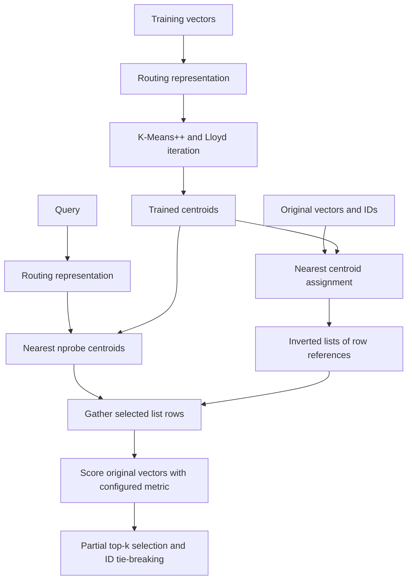

# IVF and K-Means design

## Motivation and data flow

Exact search scores every stored vector, O(Nd) per query. IVF trades retrieval
quality for the opportunity to score fewer vectors. It learns K centroids
(`nlist`) and stores each vector in exactly one nearest-centroid list. There is
no measured speedup claim: training, routing, and gathering can outweigh reduced
scoring for small datasets.

## K-Means++ initialization

The first center is a seeded uniform sample. Each later center is sampled with
probability proportional to its squared distance from the nearest chosen center.
Weights are divided by their maximum before normalization, avoiding overflow when
summing large weights. If all remaining distances are zero, the lowest unused
sample row is chosen. Duplicate centroid locations are permitted when there are
fewer distinct locations than requested clusters.

The RNG is a local `numpy.random.default_rng(random_state)`. Seeds are nonnegative
signed int64 values for persistence; global RNG state is never consumed. Repeated
runs with identical input order, configuration, and seed are reproducible in the
same numerical environment.

## Lloyd iteration, recovery, and stopping

Samples are assigned to nearest centers using squared Euclidean distance. Equal
computed distances choose the lowest centroid ID. Empty clusters are visited in
ascending centroid order. Samples are prioritized by descending distance to their
assigned center, then ascending sample row. The first sample whose current cluster
contains more than one member is moved to the empty cluster. Counts are updated
immediately, so a donor never becomes empty and a sample moved into a singleton
cannot be stolen again. With N >= K, there is always an eligible donor. Recovery
visits each empty cluster once and cannot loop indefinitely.

Means are recomputed from this repaired partition using an anchor plus the mean
of centered offsets. Identical samples keep exactly identical centroid locations
instead of introducing different rounding errors for different cluster counts.

Stop when repaired labels match the preceding iteration, the largest L2 centroid
movement is <= tol (absolute coordinate units), or max_iter updates have run.
`n_iter_` counts completed updates. `labels_` records the partition used to compute
the final means; every cluster is represented. `inertia_` is the sum of squared
distances to the assigned final means. Labels, means, and inertia therefore
describe one consistent partition, including when max_iter=1.

At the tolerance/iteration limit, a fresh nearest-centroid prediction may differ
from training labels. Duplicate centers also make a nonempty partition incompatible
with sending all tied samples to the lowest centroid ID. `predict` deliberately
uses the nearest/lowest-ID rule and does not repair empty prediction clusters.
IVF insertion uses nearest-centroid prediction, never training labels, so training
recovery does not create inconsistent IVF assignments.

Fitted arrays and statistics are staged locally. Failed first fitting leaves the
model unfitted; failed refitting preserves all previous results. Public array
properties return copies. Prediction expects an `(N, d)` matrix, including `(0, d)`.

## IVF representation and lifecycle

IVF owns one `(N, d)` float64 array of original vectors, a parallel `(N,)` int64 ID
array, an `(N,)` int64 assignment array, `(K, d)` centroids, and a tuple of K int64
arrays of row references. Each row occurs in exactly one list. Lists do not copy
vector data. Rebuilding references scans assignments once per cluster; this favors
clear validation and atomic mutations over optimizing high-volume writes.

Untrained indexes have no centroids or usable lists. Training initializes all K
empty lists but inserts no vectors. Add requires trained state and stages vector,
ID, assignment, and list arrays before committing. Duplicate IDs, shape errors,
nonfinite values, routing overflow, and allocation errors preserve existing state.
Deletion ignores missing/repeated IDs, compacts rows, and rebuilds lists; stable
IDs remain unchanged. Deleting all vectors preserves training. Empty indexes can
be retrained atomically; populated indexes reject retraining. Deletion on an
untrained index is a validated no-op.

## Routing, scoring, and determinism

Euclidean and dot indexes train and route using original vectors. Dot routing is
only a Euclidean clustering heuristic and provides no maximum-inner-product
optimality guarantee. Cosine normalizes training samples, inserted samples, and
queries with Phase 1's overflow-resistant normalization. Zero vectors stay zero.
Cosine centroids remain arithmetic means within the unit ball; they are not
themselves normalized before L2 routing.

Search validates query, k, and effective nprobe, then chooses nearest centroids,
with ascending centroid IDs on distance ties. Selected lists can be empty. At most
k candidates are returned; extra lists are never added just to fill k. Original
vectors are scored using Phase 1 cosine, L2, or dot semantics, including zero-vector
cosine=0. Shared `_ranking.py` locates the kth cutoff with argpartition, resolves
the entire boundary tie by smallest stable IDs, then sorts the selected rows.
Exact search delegates to this helper without changing its public contract.

Full probing uses the original row sequence directly: every candidate is included,
and scoring follows the exact index's reduction order. IDs/order and equivalent
scores match for identical stored datasets. Routing distances are unnecessary
in this case and are skipped. A per-call nprobe override never changes the default
`nprobe` property. Both are validated against `1 <= nprobe <= nlist`.

## Numerical behavior

Distance computation allocates `(N, K)` and loops over centers, with an `(N, d)`
difference temporary per center. It avoids `(N, K, d)` storage and cancellation
from `||x||² + ||c||² - 2 x.c`. Direct squared differences are nonnegative, without
clipping negative roundoff. Nonfinite squared distances, means, movement, or total
inertia raise `ValueError` before state changes. Huge finite inputs whose squared
differences overflow are rejected meaningfully. Float64 underflow can turn tiny
distances into ties; tie policies still apply. Cross-platform roundoff can change
nearly tied assignments or scores.

## Complexity and memory

Let T be training samples, K=nlist, d=dimension, I=iterations, N=stored rows,
B=inserted rows, C=candidates, and k'=min(k,C).

- K-Means++ initialization: O(TKd).
- Lloyd iteration: O(TKd), plus O(T log T + KT) in the worst case when empty-cluster
  recovery sorts losses and scans donors. Training totals initialization plus I
  such iterations. Storage: O(TK + Td + Kd), without a TKd tensor.
- Insertion: O(BKd) routing, O((N+B)d) copying, and O(K(N+B)) reference rebuilding.
  Batch uniqueness adds O(B log B); NumPy membership checks can also sort depending
  on ID ranges, rather than always taking linear time.
- Deletion: membership filtering, O(Nd) copying, and O(KN) reference rebuilding.
- Partial search: O(Kd) routing, O(K + nprobe log nprobe) centroid selection/sorting,
  O(Cd) gathering/scoring, and O(C + k' log k') result selection/sorting.
- Full search: O(Nd + N + min(k,N) log min(k,N)), matching exact search.
- Persistent memory: O(Nd + N + Kd + K), with N references across lists. Mutation
  staging, validation, normalization, and scoring temporarily allocate more arrays.

Increasing nprobe yields nested candidate sets under deterministic centroid
ordering and usually improves recall while scoring more vectors. It provides no
general partial-probe recall guarantee or measured speed improvement. Large K can
produce sparse/unbalanced lists and increases training/routing cost.

## Persistence and evaluation

`ivf_storage.py` owns an independent version-1 schema with exactly fourteen fields:
`index_type`, `ivf_format_version`, `dimension`, `metric`, `vectors`, `ids`, `nlist`,
`nprobe`, `centroids`, `assignments`, `max_iter`, `tol`, `random_state`, `is_trained`.
Only trained indexes are persisted; trained-empty archives retain `(0, d)` vectors,
integer IDs/assignments, and valid centroids. Restoring does not retrain.

Loading uses `allow_pickle=False` and validates scalar types, configuration, schema,
unique int64 IDs, finite vectors/centers, shape, assignment range, cosine center
norms, and nearest-centroid assignment consistency before constructing the index.
Lists are rebuilt from validated assignments. Unexpected/duplicate ZIP fields,
wrong index types, incompatible versions, and corrupt arrays are rejected. Exact
archives keep their original five-field schema; the two formats cannot interchange.

Saving validates the complete payload and any target first. Valid targets must
match dimension, metric, and nlist. A temporary sibling file is flushed and fsynced
before os.replace; failures clean up the temporary and preserve the old target.
This repeats a small amount of Phase 1 I/O code to keep its schema and loader
untouched. Filesystem errors retain their OSError subtype. No archive size limits,
multiwriter locks, or power-loss guarantees beyond the existing pattern are added.
Validation recomputes routing, so save/load also cost O(NKd).

`evaluation.py` compares first-k stable ID sets, divides by the number of exact
results, and returns per-query/mean recall. Empty exact results score 1 by
convention; zero query rows are rejected. Exact cutoff ties use ascending IDs,
without expanding ground truth to other tied IDs. Callers ensure equal datasets;
matching dimension/metric is validated. Only full probing guarantees recall=1 for
identical data. This utility records quality only; no Phase 3 timing, throughput,
memory benchmarking, or FAISS integration is included.
