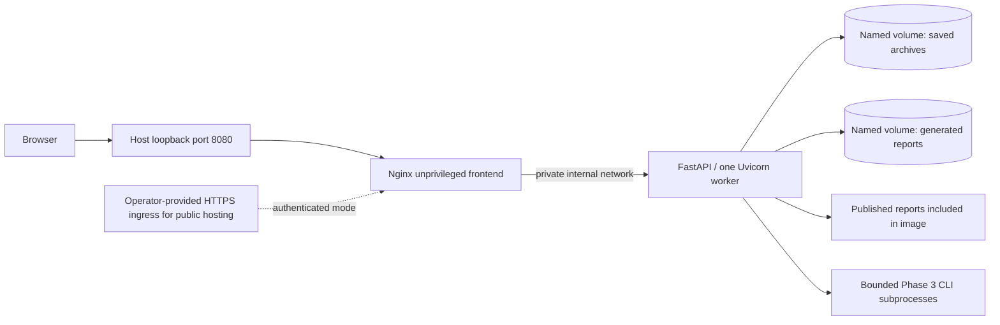

# Phase 5: Compose deployment and continuous integration

This repository can be built as separate FastAPI and static frontend containers.
It remains a single-user search laboratory. The engine algorithms, stable int64
IDs, NPZ formats, and Phase 3 benchmark methodology are unchanged. No cloud
provider, domain, credentials, image registry publication, or live deployment is
configured. Image publishing and deployment require a later explicit approval.

## Architecture



Only the frontend publishes a host port, bound to 127.0.0.1 by default. Nginx
serves the Vite production build, handles SPA refreshes, and proxies `/api/`,
`/docs`, `/docs/oauth2-redirect`, and `/openapi.json`. The backend has no published
port and joins only an internal network. The frontend also joins an edge bridge
network for port publishing. Nginx uses Docker DNS with a short cache so replacing
the backend does not permanently retain its old IP address.

The backend's multi-stage build uses Python 3.12 slim Bookworm and uv 0.11.28.
Both web and benchmark extras are installed with `uv sync --locked --no-dev`;
the final project install is non-editable. The runtime copies the environment,
backend source, and published report fixtures, not a developer .venv or generated
results. libgomp1 supports native FAISS libraries. Runtime UID/GID is 10001.

The frontend uses a Node 24 build stage and `npm ci`, then the upstream
unprivileged stable Alpine Nginx image (UID/GID 101). It does not run Vite in
production. Browser API requests remain same-origin `/api/v1`; port 8000 is never
hardcoded into browser-facing production requests.

Dependencies are locked; base-image family tags receive upstream security
updates. Builds are not claimed to be byte-identical across time. Before a
controlled release, select and record verified image digests and update them
deliberately. The uv tool image is version pinned, and CI actions use commit SHAs.

## Prerequisites and local startup

- A suitable Linux Docker Engine host with the Docker Compose v2+ plugin, or
  Docker Desktop running Linux containers on Windows/macOS.
- Approximately 2 GiB available RAM for building/running the small default setup,
  plus build cache and persistent storage. Native NumPy/FAISS code needs a
  compatible host CPU and wheel platform. Linux x86-64 is the intended CI target.
- Free local frontend port 8080 (configurable). No production secrets are needed
  for localhost-only use.

From the checkout:

```sh
docker compose config --quiet
docker compose up --build -d
docker compose ps
docker compose logs -f
```

Open `http://127.0.0.1:8080`. API health is `/api/v1/health`; Swagger is `/docs`.
`/healthz` is a constant frontend liveness response and contains no application
data. Press Ctrl+C to leave log following; that does not stop the application.

```sh
docker compose down
```

Normal shutdown retains the named volumes. Do not add the volume-removal flag:
that would destroy explicitly saved indexes and generated reports. Do not change
the Compose project name when expecting the same default named volumes to reattach.

## Source development remains supported

```powershell
uv sync --locked --extra web --extra benchmark
uv run --extra web --extra benchmark python -m backend.serve
```

In another terminal:

```powershell
cd frontend
npm ci
npm run dev
```

Open `http://127.0.0.1:5173`. Existing direct Uvicorn startup commands still work,
but explicit `uvicorn --host/--port` flags control binding when using that command.
`python -m backend.serve` reads the environment-based host and port and enforces
one worker. Never add multiple workers: active catalogs and job queues are not
shared across processes.

## Environment configuration

Copy `.env.example` to a private `.env` for Compose overrides (`cp` on Linux or
`Copy-Item .env.example .env` in PowerShell). Do not commit the private file.
Compose reads `.env`; source Python runs read process environment variables,
not `.env` automatically. Frontend development has its separate `.env.example`.

| Variable | Source default | Container behavior |
| --- | --- | --- |
| VECTORFORGE_ENV | development | production, set by Compose |
| VECTORFORGE_API_HOST | 127.0.0.1 | 0.0.0.0 inside private container |
| VECTORFORGE_API_PORT | 8000 | Shared with proxy, health probe, image expose metadata |
| VECTORFORGE_BIND_ADDRESS | N/A | 127.0.0.1 host publication |
| VECTORFORGE_FRONTEND_PORT | N/A | 8080 host publication |
| VECTORFORGE_ALLOWED_HOSTS | localhost,127.0.0.1,testserver in development | localhost,127.0.0.1,backend in Compose |
| VECTORFORGE_CORS_ORIGINS | localhost/127.0.0.1 port 5173 | Empty for same-origin deployment |
| VECTORFORGE_ENABLE_DOCS | true | Can disable Swagger/OpenAPI |
| VECTORFORGE_ENABLE_BENCHMARKS | true | Can disable new benchmark jobs; saved reports remain readable |
| VECTORFORGE_DATA_DIR | `<repo>/.vectorforge` | `/var/lib/vectorforge/data`, named volume |
| VECTORFORGE_RESULTS_DIR | `<repo>/results` | `/var/lib/vectorforge/results`, named volume |
| VECTORFORGE_PUBLISHED_DIR | `<repo>/docs/benchmark_results` | Image's read-only published fixtures |
| VECTORFORGE_MAX_INDEXES | 16 | May reduce to 1–16 |
| VECTORFORGE_MAX_PENDING_JOBS | 2 total running/queued | May reduce to 1–2; one executes at a time |
| VECTORFORGE_JOB_TIMEOUT | 180 seconds | May reduce to 1–180 |

Production API ports must be >=1024 for the non-root user. Allowed hosts are
explicit hostnames/IPs without ports or wildcard patterns. CORS accepts explicit
HTTP(S) origins only, without paths, credentials, or wildcards. Production defaults
have no CORS origins and omit testserver from allowed hosts. For a future public
hostname, explicitly add that hostname to allowed hosts; do not use `*`.

Other Phase 4 limits remain unchanged, including 4 MiB requests, vector dimensions,
batch sizes, archive/report sizes, coordinate budgets, and bounded quick jobs.
The dashboard shows configured job capacity/deadline and a clear disabled message.

## Persistent storage, permissions, and restart behavior

Compose creates `index_data` and `benchmark_reports` named volumes (prefixed with
the Compose project name). Image directories are pre-owned by UID/GID 10001;
new empty volumes initialize from those directories. Production startup checks
that both configured storage roots are writable, rather than silently continuing
with unusable storage. Existing bind mounts must be prepared with suitable
ownership/permissions; a host bind mount hides the image's directory ownership.

Saved NPZ files and their application manifests live under the data volume's
`indexes/` directory. Generated benchmark JSON, CSV, samples, and charts live in
the report volume. Published example reports are versioned files included in the
backend image, so they remain available after recreation without a writable
published-report mount. Do not overwrite those fixtures with generated outputs.

Active indexes and job history are ephemeral. Save explicitly before restart;
load by saved archive ID afterward. Report IDs are stable for the same source and
relative report path. In-flight benchmark jobs are terminated during shutdown,
not resumed. A partial output folder may remain and is reported as invalid rather
than converted into a fabricated successful benchmark. Compose uses an init
process and a 30-second backend grace period to support child cleanup.

For a consistent backup, stop backend mutations/jobs and copy both volumes:

```sh
docker compose stop backend
mkdir -p backups
docker compose cp backend:/var/lib/vectorforge/data backups/data
docker compose cp backend:/var/lib/vectorforge/results backups/results
docker compose start backend
```

Copy backups to protected storage outside the Docker host and record the image
revision. Backups can contain user vector data and local environment metadata.
To restore into an existing, stopped stack, copy contents back, repair ownership
in a one-off administrator operation, then start normally:

```sh
docker compose stop backend
docker compose cp backups/data/. backend:/var/lib/vectorforge/data
docker compose cp backups/results/. backend:/var/lib/vectorforge/results
docker compose run --rm --user 0 --cap-add CHOWN --cap-add DAC_OVERRIDE backend sh -c 'chown -R 10001:10001 /var/lib/vectorforge/data /var/lib/vectorforge/results'
docker compose start backend
```

The temporary root/capability override is for repair only. Normal services remain
non-root with capabilities dropped. Verify restored archives via the UI or smoke
workflow before relying on a backup. No NPZ schema migration is introduced.

## Access control and public-hosting requirements

Default Compose is for loopback-only use. The frontend startup policy refuses
non-loopback binding in local access mode. For any public-hosting preparation,
use `compose.auth.yaml`; it requires an operator-created, readable, nonempty
htpasswd secret. The whole UI, API, and Swagger/OpenAPI surface is protected by
HTTP Basic authentication in that mode. Only constant `/healthz` stays public.
Nginx removes Authorization before forwarding to the private backend.

Example setup on a Linux host with `htpasswd` installed:

```sh
mkdir -p .secrets
chmod 700 .secrets
htpasswd -cB .secrets/vectorforge.htpasswd YOUR_ACCOUNT_NAME
chmod 644 .secrets/vectorforge.htpasswd
export VECTORFORGE_HTPASSWD_FILE="$PWD/.secrets/vectorforge.htpasswd"
docker compose -f compose.yaml -f compose.auth.yaml config --quiet
docker compose -f compose.yaml -f compose.auth.yaml up --build -d
```

Choose your own account and a strong password at the interactive prompt. No
credentials are provided or generated for deployment. The protected host directory
restricts local traversal; the mounted file must be readable by container UID 101.
Compose secrets are read-only file mounts, not an encrypted external secret store.
The proxy fails startup if the file is absent/unreadable/empty; bad password hashes
deny access rather than silently turning authentication off.

**Basic authentication must be used behind HTTPS before public exposure.** Keep
the host binding at 127.0.0.1 and place an operator-configured HTTPS ingress in
front. If binding elsewhere for an appropriate private/TLS network, authenticated
mode is mandatory. This repository does not configure a provider, public DNS, TLS
certificate, or trust arbitrary forwarded headers. Uvicorn ignores proxy headers;
browser requests and OpenAPI use the same externally visible origin.

Nginx adds CSP, nosniff, frame protection, referrer and permissions policies, plus
request size/rate limits. Swagger's location-specific CSP permits its existing
CDN/inline initialization; the SPA uses a stricter script policy. Swagger needs
browser access to its CDN, as in the source application. The backend runs with a
read-only root filesystem, bounded writable tmpfs, memory/PID limits, and no added
capabilities. Application storage is the only persistent writable data area.

Production API responses hide internal report/archive diagnostics, benchmark
logs, output-directory paths, and detailed job failures. Server logs retain job
IDs and diagnostic details for the operator. CORS and host checks are defense in
depth, not authentication. A host administrator or anyone with Docker-socket access
can bypass Compose controls; do not expose the Docker socket. This is not a
multi-tenant service, hostile-file sandbox, or complete internet-facing security
platform. Review TLS, firewall policy, updates, backups, and access logging before
selecting a public deployment target.

## Tests, CI, and container smoke workflow

```powershell
uv sync --locked --extra web --extra benchmark
uv run --extra web --extra benchmark pytest -v
uv run ruff check .
uv run ruff format --check .
cd frontend
npm ci
npm run typecheck
npm run build
npm test
npm run test:e2e
```

Playwright defaults to installed Edge on Windows and Chromium on Linux. CI
explicitly installs Chromium and its OS dependencies and sets
`PLAYWRIGHT_CHANNEL=chromium`. For local Chromium, install it with
`npx playwright install chromium` and set that variable. Browser tests start their
own source API/Vite servers; stop other servers on 8000/5173 first.

`.github/workflows/ci.yaml` runs on pushes/PRs with read-only repository permissions:

- Python job: locked install, explicit native FAISS import, Ruff and full pytest.
- Frontend job: cached npm/uv downloads, type check, production build, Vitest,
  and Linux Chromium Playwright workflows, including a real bounded benchmark.
- Docker job: Compose configuration, both builds, health/startup, real HTTP
  Exact/IVF/save/search operations, bounded quick benchmark, forced recreation,
  archive/report persistence, and authenticated proxy checks. Temporary CI-only
  credentials are generated and masked; no production secrets are required.

No workflow publishes images or deploys. Hosted CI has not run until you push
these changes after review. Failed browser artifacts are retained for seven days.
Docker cleanup uses normal `down`, retaining volumes for the duration of its host.

To reproduce the real container workflow on a Docker-capable host:

```sh
docker compose up --build -d --wait --wait-timeout 120
python scripts/container_smoke.py before
docker compose up -d --force-recreate --wait --wait-timeout 120
python scripts/container_smoke.py after
```

The `before` phase launches a real quick benchmark, so allow up to 200 seconds.
Run `after` immediately after recreation, before manually loading indexes; it
checks that the active catalog is empty, then restores Exact/IVF archives and
compares IDs and raw scores. It also checks published and generated reports.
State is stored under ignored `.vectorforge/`. This script is intended for an
isolated smoke instance; it does not delete user data but adds test archives/runs.

## Local validation results

Validation performed in the Windows implementation workspace:

| Check | Result |
| --- | --- |
| Complete Python suite, including FAISS integration | 585 passed (551 existing + 34 new); one upstream Starlette/httpx deprecation warning |
| Ruff lint and format checks | Passed |
| Frontend TypeScript and production build | Passed |
| Vitest | 8 passed |
| Playwright workflows on Windows Edge | All 4 passed, including the real bounded benchmark |
| Production source entry point and health probe | Passed with a custom port and temporary writable storage roots |
| Compose base and authenticated override configuration | Passed with checksum-verified standalone Compose 5.6.1; no daemon required |
| Compose and workflow YAML syntax | Passed |
| Docker builds, Nginx runtime/authentication, container recreation and volume persistence | Not run: no Docker/Podman runtime or daemon available |
| Hosted GitHub Actions and Linux Chromium | Authored, not executed in this workspace |

The new tests cover environment validation, storage across app recreation,
production response redaction, reduced workload limits, and executable proxy
startup policy checks. No existing test logic or core engine code was changed.

## Troubleshooting and verification boundary

- **Docker command missing:** install Docker Engine/Compose or Docker Desktop;
  enable Linux containers and start the daemon. No container runtime was available
  in the implementation workspace, so actual builds, Nginx behavior, volume
  initialization, container restarts, authentication over HTTP, and containerized
  benchmarks require verification on a Docker-capable host. Do not read the
  authored CI smoke steps as already executed results.
- **Permission errors:** check mounted data roots and UID/GID 10001 ownership.
  Prefer fresh named volumes for initial use. Do not fix this by running the
  service permanently as root or opening directories to everyone.
- **Unhealthy backend:** inspect `docker compose logs backend`; verify port,
  explicit allowed hosts, valid environment values, writable mounts, native CPU
  compatibility and available RAM. The health probe uses the configured port.
- **Proxy startup refuses binding:** use loopback for local mode, or supply the
  authenticated override and password file. Verify UID 101 can read the secret.
- **401 responses:** provide your proxy account credentials; healthz being 200
  does not mean the API is authenticated or ready. Backend readiness is separate.
- **502 after replacement:** allow Docker DNS cache expiry and backend health
  startup; inspect both service logs. Do not hardcode a container IP address.
- **Disabled benchmarks:** inspect the enable flag and optional dependencies.
  Existing reports work even with execution disabled. Limits may be reduced, not
  raised past Phase 4 ceilings.
- **Native job failure/OOM:** inspect operator logs by job ID. Container memory
  limits do not measure peak index memory or make native workloads free of OOM.
- **API/docs disabled or host rejected:** set an explicit allowed hostname and
  the docs flag, then recreate services. Environment edits do not change a running
  container automatically.

After local review, the next public-deployment steps are: validate the Docker CI
job on Linux, select a host/domain, create credentials, configure a maintained
HTTPS ingress/firewall, verify backups/restores, choose image digests, and approve
deployment. No live URL is claimed.

References: [uv Docker integration](https://docs.astral.sh/uv/guides/integration/docker/),
[Nginx unprivileged image](https://github.com/nginx/docker-nginx-unprivileged),
[Docker Compose secrets](https://docs.docker.com/compose/how-tos/use-secrets/),
[Docker port publishing](https://docs.docker.com/engine/network/port-publishing/).
